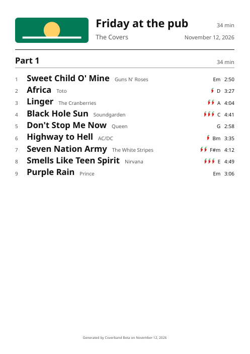
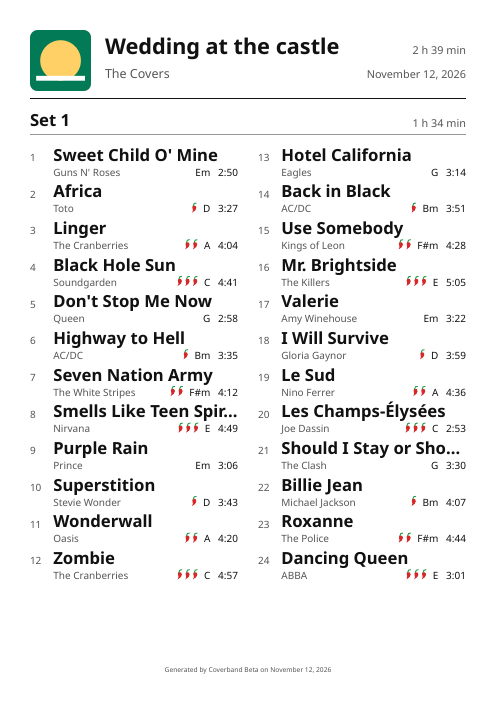
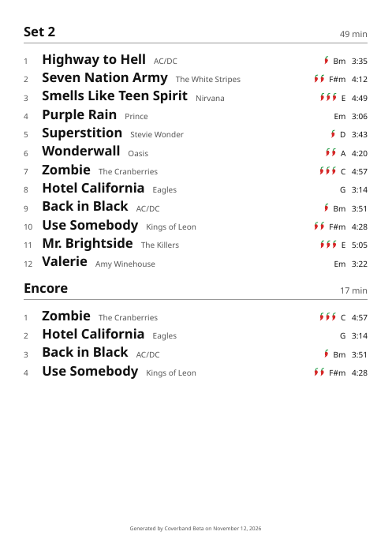
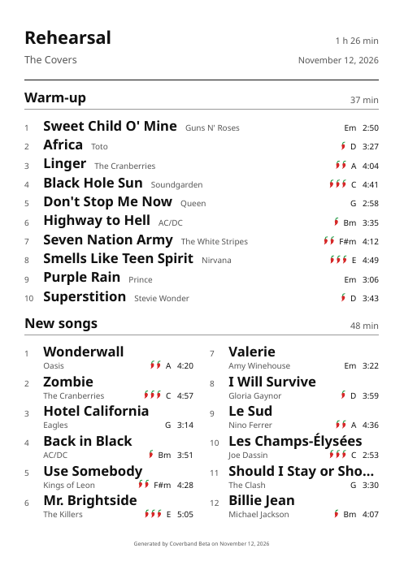
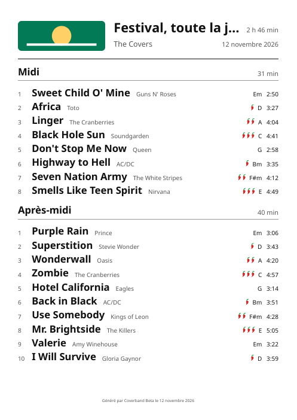
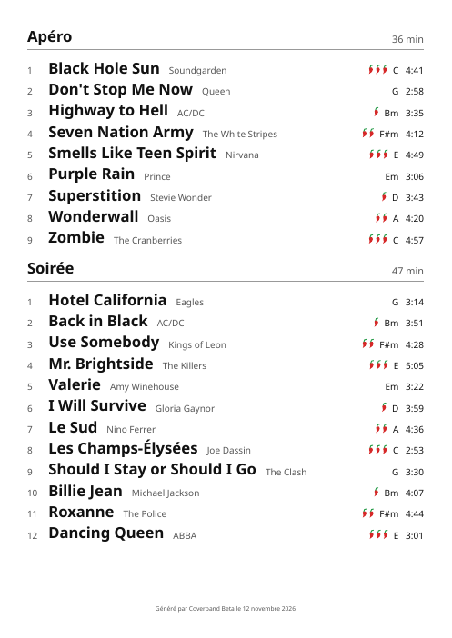
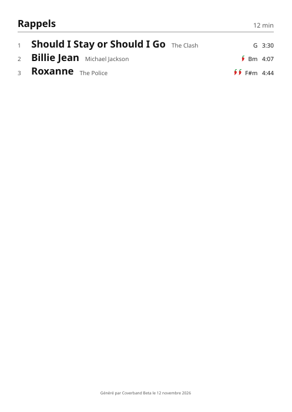
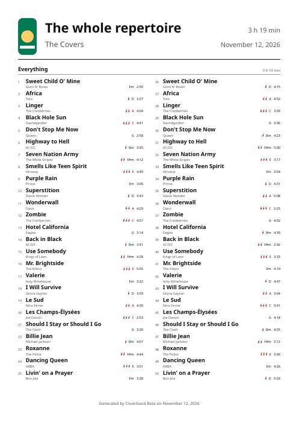
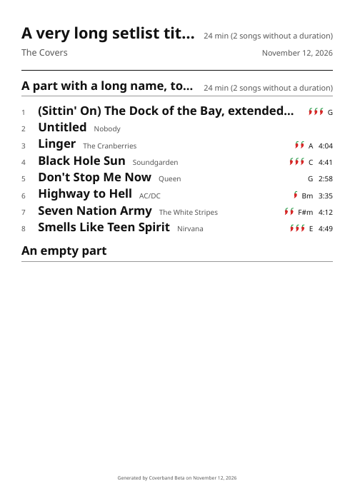
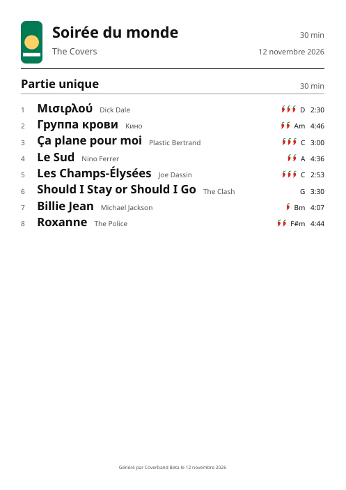

# Setlist PDF examples

> 🕒 Examples drawn on Thursday 2026/11/12

How the printed setlist (brief 030, #298) handles its edge cases, made from fixed data by `bun run setlist:examples` (`apps/api/src/dev/setlist-examples.ts`, the data in `apps/api/src/modules/setlists/pdf-examples.ts`). Draw them again after changing the PDF: the files only change when the PDF does. The images need `pdftoppm` (`sudo apt install poppler-utils`). The layout's tests check the same setlists (`pdf-layout.test.ts`: every part once, in order, whole within its page; only the 50-song part made smaller).

The rules (`layoutSetlist`, `pdf-layout.ts`): a part goes on one column if it fits what's left of the page, else on two (each song's details then on a second, small line), else on the next page; a part is never split; parts share a page when they fit. Last resort, one smaller scale for the whole document, the largest at which every part fits a page.

## 01: a short setlist

One short part: one column, full size, one page. A wide logo.

[PDF](01-short.pdf)

## 02: a long first set

A long first set on two columns; the next two sets share the second page, on one column.

[PDF](02-long-first-set.pdf)

 

## 03: two columns rather than a new page

The second part wouldn't fit what's left of the first page on one column: on two columns, it stays on that page.

[PDF](03-two-columns-same-page.pdf)

## 04: five parts

Five parts (the most a setlist has), in French: each whole, two to a page. The last one, three songs, lands alone on a third page: the rule keeps a part on one column whenever it fits, so the fourth part, on one column, leaves too little room. Putting it on two columns would have kept everything on two pages, at the cost of a less readable fourth part.

[PDF](04-five-parts.pdf)

  

## 05: fifty songs in one part

One part of 50 songs (the most a setlist has): it only fits on one page with everything smaller (scale 0.55, the smallest), on two columns. A tall logo.

[PDF](05-fifty-songs.pdf)

## 06: long texts, missing details

Long titles and artists cut with "…" (the setlist's title and a part's name too); songs without a duration (the totals say how many), key or energy; an empty part; no logo.

[PDF](06-long-texts-missing-details.pdf)

## 07: French, other scripts

In French: accents, and titles in Greek and Cyrillic written by the bundled font (Noto Sans); the band's own key and duration. Keys are printed with `#` and `b` ("F#m", "Db"): the font has no ♯ nor ♭.

[PDF](07-french-other-scripts.pdf)

